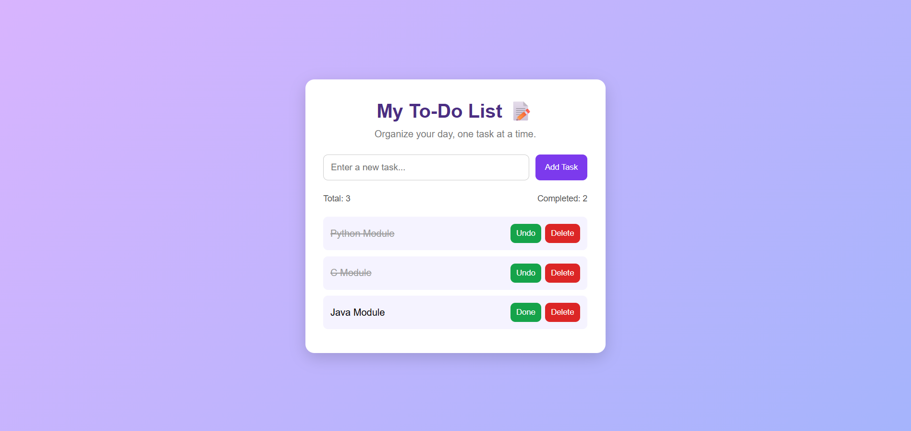

# Ex03 To-Do List using JavaScript
## Date: 17-11-2026

## Name: DEEPIKA A.
## REG. NO.: 212225040058

## AIM
To create a To-do Application with all features using JavaScript.

## ALGORITHM
### STEP 1
Build the HTML structure (index.html).

### STEP 2
Style the App (style.css).

### STEP 3
Plan the features the To-Do App should have.

### STEP 4
Create a To-do application using Javascript.

### STEP 5
Add functionalities.

### STEP 6
Test the App.

### STEP 7
Open the HTML file in a browser to check layout and functionality.

### STEP 8
Fix styling issues and refine content placement.

### STEP 9
Deploy the website.

### STEP 10
Upload to GitHub Pages for free hosting.

## PROGRAM

### HTML
```

<!DOCTYPE html>
<html lang="en">
<head>
    <meta charset="UTF-8">
    <meta name="viewport" content="width=device-width, initial-scale=1.0">
    <title>My To-Do List</title>
    <link rel="stylesheet" href="style.css">
</head>
<body>

    <div class="container">
        <h1>My To-Do List 📝</h1>
        <p class="subtitle">Organize your day, one task at a time.</p>

        <div class="input-section">
            <input type="text" id="taskInput" placeholder="Enter a new task...">
            <button id="addBtn">Add Task</button>
        </div>

        <div class="task-info">
            <span id="totalTasks">Total: 0</span>
            <span id="completedTasks">Completed: 0</span>
        </div>

        <ul id="taskList"></ul>

        <p id="emptyMessage">No tasks yet. Add your first task!</p>
    </div>

    <script src="script.js"></script>
</body>
</html>
```

 ### CSS
```
* {
    margin: 0;
    padding: 0;
    box-sizing: border-box;
}

body {
    font-family: Arial, sans-serif;
    background: linear-gradient(135deg, #d8b4fe, #a5b4fc);
    min-height: 100vh;
    display: flex;
    justify-content: center;
    align-items: center;
    padding: 20px;
}

.container {
    background: white;
    width: 100%;
    max-width: 500px;
    padding: 30px;
    border-radius: 15px;
    box-shadow: 0 8px 25px rgba(0, 0, 0, 0.15);
}

h1 {
    text-align: center;
    color: #4b2e83;
    margin-bottom: 10px;
}

.subtitle {
    text-align: center;
    color: #777;
    margin-bottom: 25px;
}

.input-section {
    display: flex;
    gap: 10px;
}

input {
    flex: 1;
    padding: 12px;
    border: 1px solid #ccc;
    border-radius: 8px;
    outline: none;
    font-size: 15px;
    min-width: 0;
}

input:focus {
    border-color: #7c3aed;
}

button {
    background: #7c3aed;
    color: white;
    border: none;
    padding: 12px 16px;
    border-radius: 8px;
    cursor: pointer;
}

button:hover {
    background: #5b21b6;
}

.task-info {
    display: flex;
    justify-content: space-between;
    margin: 22px 0;
    color: #555;
    font-size: 14px;
}

ul {
    list-style: none;
}

li {
    display: flex;
    justify-content: space-between;
    align-items: center;
    background: #f5f3ff;
    padding: 12px;
    border-radius: 8px;
    margin-bottom: 10px;
    gap: 10px;
}

.task-text {
    flex: 1;
    overflow-wrap: anywhere;
}

.completed {
    text-decoration: line-through;
    color: #999;
}

.task-actions {
    display: flex;
    gap: 6px;
}

.complete-btn {
    background: #16a34a;
    padding: 8px 10px;
}

.delete-btn {
    background: #dc2626;
    padding: 8px 10px;
}

#emptyMessage {
    text-align: center;
    color: #999;
    margin-top: 20px;
    font-size: 14px;
}

@media (max-width: 400px) {
    .container {
        padding: 20px;
    }

    .input-section {
        flex-direction: column;
    }
}
```

### JAVASCRIPT
```

const taskInput = document.getElementById("taskInput");
const addBtn = document.getElementById("addBtn");
const taskList = document.getElementById("taskList");
const totalTasks = document.getElementById("totalTasks");
const completedTasks = document.getElementById("completedTasks");
const emptyMessage = document.getElementById("emptyMessage");

// Load saved tasks
let tasks = JSON.parse(localStorage.getItem("tasks")) || [];

// Display tasks
function displayTasks() {
    taskList.innerHTML = "";

    tasks.forEach((task, index) => {
        const li = document.createElement("li");

        const span = document.createElement("span");
        span.textContent = task.text;
        span.className = "task-text";

        if (task.completed) {
            span.classList.add("completed");
        }

        const actions = document.createElement("div");
        actions.className = "task-actions";

        const completeBtn = document.createElement("button");
        completeBtn.textContent = task.completed ? "Undo" : "Done";
        completeBtn.className = "complete-btn";

        completeBtn.addEventListener("click", () => {
            tasks[index].completed = !tasks[index].completed;
            saveTasks();
        });

        const deleteBtn = document.createElement("button");
        deleteBtn.textContent = "Delete";
        deleteBtn.className = "delete-btn";

        deleteBtn.addEventListener("click", () => {
            tasks.splice(index, 1);
            saveTasks();
        });

        actions.appendChild(completeBtn);
        actions.appendChild(deleteBtn);

        li.appendChild(span);
        li.appendChild(actions);

        taskList.appendChild(li);
    });

    // Update task information
    totalTasks.textContent = `Total: ${tasks.length}`;

    const completedCount = tasks.filter(
        task => task.completed
    ).length;

    completedTasks.textContent = `Completed: ${completedCount}`;

    emptyMessage.style.display =
        tasks.length === 0 ? "block" : "none";
}

// Add a new task
function addTask() {
    const taskText = taskInput.value.trim();

    if (taskText === "") {
        alert("Please enter a task!");
        return;
    }

    tasks.push({
        text: taskText,
        completed: false
    });

    taskInput.value = "";

    saveTasks();
}

// Save tasks to localStorage
function saveTasks() {
    localStorage.setItem("tasks", JSON.stringify(tasks));
    displayTasks();
}

// Button click event
addBtn.addEventListener("click", addTask);

// Enter key event
taskInput.addEventListener("keypress", (event) => {
    if (event.key === "Enter") {
        addTask();
    }
});

// Initial display
displayTasks();
```
## OUTPUT


## RESULT
The program for creating To-do list using JavaScript is executed successfully.